# API de gerenciamento de tarefas com FastAPI e SQLite

## 1 Objetivo e resultado final

Este trabalho implementa e hospeda uma API REST de gerenciamento de tarefas fictícias. A solução usa Python, FastAPI e SQLite em uma VM Debian 12 na Microsoft Azure. O CRUD público, a validação e a persistência foram verificados; a aplicação permanece ligada para apresentação.
Foram aprovados 17 testes locais e 23 requisições públicas registradas, além de operações no Swagger e verificações de rede. Uma tarefa permaneceu idêntica após reiniciar o serviço e depois a VM. Backup e restauração em arquivo separado também foram testados na nuvem. 
Nome completo: pendente. Matrícula: pendente. Turma: pendente. Disciplina: pendente. Professor: pendente. Verificações em 02/11/2026, com registros técnicos em UTC.
Repositório: https://github.com/shamiryy/api-tarefas-fastapi-sqlite
API pública para consulta: https://tarefas-academica-shamiryy-20261102.mexicocentral.cloudapp.azure.com/tarefas
Swagger: https://tarefas-academica-shamiryy-20261102.mexicocentral.cloudapp.azure.com/docs
Saúde: https://tarefas-academica-shamiryy-20261102.mexicocentral.cloudapp.azure.com/health
OpenAPI: https://tarefas-academica-shamiryy-20261102.mexicocentral.cloudapp.azure.com/openapi.json
O caminho raiz / não possui rota; use /docs ou /tarefas. Os links foram verificados. A disponibilidade futura depende de manter a VM, o serviço e os créditos.

## 2 Linguagem e bibliotecas

Python é uma linguagem de alto nível. As anotações de tipos descrevem os dados e permitem que o FastAPI e o Pydantic validem entradas. FastAPI define rotas HTTP e gera o esquema OpenAPI e a interface Swagger. Uvicorn executa a aplicação pelo protocolo ASGI. O módulo sqlite3 faz parte da biblioteca padrão do Python e acessa um banco em arquivo, sem servidor de banco separado.
Versões efetivamente executadas: fastapi 0.162.0; uvicorn 0.54.0; pydantic 2.14.2; starlette 1.10.0; pytest 9.2.0; httpx 0.28.1; playwright 1.64.1; Python 3.13.7; SQLite 3.50.4. Os arquivos requirements.txt e requirements-dev.txt fixam dependências diretas; requirements-lock.txt registra o ambiente completo usado, inclusive ferramentas de documentação. Use requirements-dev.txt para executar os testes e requirements.txt na implantação. Não é necessário instalar ferramentas de geração do relatório para servir a API.
O código utiliza funções síncronas nas rotas de banco: FastAPI as executa em seu conjunto de threads. Cada operação abre e fecha sua conexão SQLite, com transação e timeout de 10 segundos. A configuração implantada usa uma instância e um worker; isso simplifica o acesso ao arquivo, mas não elimina a serialização das escritas do SQLite.
Versões verificadas na VM: Python 3.11.2, SQLite 3.40.1, FastAPI 0.162.0, Uvicorn 0.54.0, Pydantic 2.14.2, Starlette 1.10.0 e Caddy 2.6.2. O sistema operacional é Debian GNU/Linux 12 (bookworm). A lista anterior identifica o ambiente local; os runtimes são distinguidos porque ambos foram testados.

## 3 Estrutura e funcionamento

app/main.py contém os modelos de entrada e saída, a fábrica create_app, a criação da tabela no ciclo de vida e as rotas. app/__init__.py identifica o pacote. tests/test_api.py contém testes isolados com diretórios temporários. scripts/backup.py realiza backup consistente e verificação de integridade. scripts/capture_local.py executa a demonstração real e salva prints e o registro do reinício. deploy contém o serviço systemd, Caddyfile, scripts de instalação e provisionamento utilizados. docs contém relatório, diagramas, instruções e evidências.
A variável DATABASE_PATH determina o arquivo SQLite. Sem configuração, o caminho é data/tarefas.db, relativo ao diretório de execução. .env.example é um exemplo e não é carregado automaticamente. Na VM implantada, o caminho absoluto é /var/lib/tarefas/tarefas.db. O Git ignora bancos, backups, .env, chaves, ambiente virtual e arquivos privados. Apenas código, documentação e evidências com dados fictícios foram incluídos.
A aplicação cria a tabela caso ela não exista; não apaga registros na inicialização. Consultas recebem valores por placeholders ?, impedindo a concatenação de dados do usuário no comando SQL. Operações de escrita são confirmadas ao sair do contexto de transação; exceções causam rollback.
Na hospedagem efetiva, deploy/provisionar.ps1 cria os recursos, deploy/instalar-azure.ps1 chama o instalador Bash pelo Azure Run Command, scripts/verify_public.py testa HTTPS/Swagger e reinicia serviço/VM quando solicitado, e scripts/check_runtime.sh verifica versões e backup. O arquivo runtime-backup.json registra o código realmente executado. Os commits posteriores também contêm ferramentas e documentação.

## 4 Modelo de dados

A tabela tarefas possui cinco campos. id: INTEGER PRIMARY KEY AUTOINCREMENT, gerado no servidor. titulo: TEXT NOT NULL, entre 1 e 120 caracteres após remoção de espaços nas extremidades. descricao: TEXT NOT NULL, até 2000 caracteres, com padrão vazio. status: TEXT NOT NULL, restrito a pendente, em_andamento ou concluida, com padrão pendente no modelo de entrada. data_criacao: TEXT NOT NULL em ISO 8601, produzida no servidor com timezone UTC e exposta como data e hora no OpenAPI.
O ID e a data não são aceitos no corpo da requisição. Campos desconhecidos são rejeitados. O esquema inclui CHECK para tamanho e valores do status. Não há tabela de usuários, autenticação nem relacionamentos. O PUT substitui os campos editáveis: omitir descricao a redefine para vazio; omitir status o redefine para pendente. A data de criação permanece inalterada.

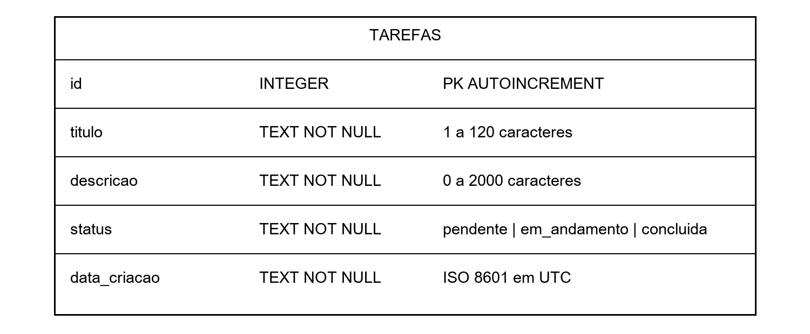

Figura 1. Modelo de dados da tabela tarefas implementada.

## 5 Contrato dos endpoints

POST /tarefas recebe JSON com titulo obrigatório e descricao/status opcionais. Retorna 201 com a tarefa criada e cabeçalho Location apontando para /tarefas/ID. GET /tarefas retorna 200 e lista em ordem de ID, com limit de 1 a 100 (padrão 100) e offset maior ou igual a zero (padrão 0). GET /tarefas/{task_id} retorna 200 com a tarefa ou 404 se o inteiro não estiver cadastrado.
PUT /tarefas/{task_id} recebe o mesmo modelo do POST e substitui todos os campos editáveis. Retorna 200; se a tarefa não existe, 404. DELETE /tarefas/{task_id} retorna 204 sem corpo; uma consulta posterior retorna 404. GET /health executa uma leitura da tabela e retorna 200 com {"status":"ok"}. Erros SQLite durante o atendimento recebem 503 com mensagem genérica sem expor caminho ou SQL.
Entradas inválidas recebem 422 com detalhe de validação, incluindo título vazio, status fora da lista, campos extras, tipo inválido e paginação fora do intervalo. Parâmetro de caminho não inteiro também recebe 422. JSON malformado recebe 422. Um ID inteiro ausente, inclusive negativo sem registro, recebe 404. Métodos sem rota correspondente recebem o tratamento padrão do framework.
A interface Swagger fica em /docs, a documentação alternativa em /redoc e o contrato em /openapi.json. Não há endpoint para baixar o arquivo do banco. A aplicação não serve diretórios como arquivos estáticos.
Falha SQLite durante inicialização impede iniciar o serviço, exigindo diagnóstico nos logs. Os erros 404 e 503 são explicados neste relatório, embora não estejam declarados individualmente como respostas de cada operação no Swagger. Não existe PATCH; PUT substitui todos os campos editáveis.

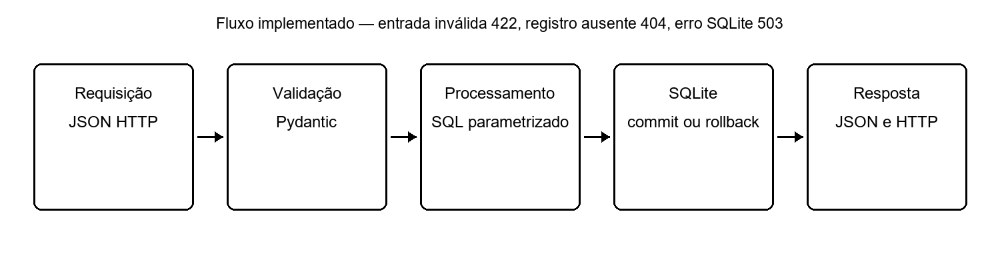

Figura 2. Fluxo de requisição e respostas implementadas.

## 6 Exemplos para apresentação

Exemplo de criação: POST /tarefas com Content-Type application/json e corpo {"titulo":"Estudar SQLite","descricao":"Exemplo fictício","status":"pendente"}. Resposta esperada pelo contrato: 201 e objeto contendo esses campos, id gerado e data_criacao UTC. Esse exemplo é ilustrativo; os IDs e horários efetivamente observados estão nos prints e em reinicio-processo-local.json.
Consulta: GET /tarefas/ID. Atualização: PUT /tarefas/ID com {"titulo":"Revisar SQLite","descricao":"Revisão fictícia","status":"concluida"}. Exclusão: DELETE /tarefas/ID. Após excluir, GET /tarefas/ID retorna {"detail":"Tarefa não encontrada"} com 404.
Para uma entrada inválida, envie {"titulo":"   "}. O servidor remove os espaços e rejeita o valor vazio com 422. Não coloque nomes, documentos, senhas ou informações reais nas tarefas da demonstração.

## 7 Execução local

Instale Python 3.13 e Git. Clone o repositório e entre na pasta. No Windows, execute os comandos abaixo no PowerShell. Se uma porta estiver em uso, escolha outra e ajuste a URL no navegador. A porta 8000 estava ocupada neste computador; o script de evidências escolheu uma porta livre automaticamente.
```powershell
git clone https://github.com/shamiryy/api-tarefas-fastapi-sqlite.git
cd api-tarefas-fastapi-sqlite
py -3.13 -m venv .venv
.venv/Scripts/python.exe -m pip install -r requirements-dev.txt
$env:DATABASE_PATH="data/tarefas.db"
.venv/Scripts/python.exe -m uvicorn app.main:app --host 127.0.0.1 --port 8088 --workers 1
```
Abra http://127.0.0.1:8088/docs. No Swagger, expanda uma rota, clique em Try it out, preencha o corpo ou o ID e clique em Execute. Verifique o código HTTP e a resposta em Server response. Interrompa o servidor com Ctrl+C; execute o mesmo comando novamente e consulte um ID que você criou para confirmar a persistência.
Execute os testes em outro terminal: `.venv/Scripts/python.exe -m pytest -v`. Os testes criam bancos temporários e não usam seu banco de demonstração. Para reproduzir os prints, instale Playwright e Chromium e execute scripts/capture_local.py; essa ferramenta é opcional e não é necessária para a API.

## 8 Testes locais e públicos executados

A suíte local aprovou 17 casos: CRUD, oito entradas inválidas, três operações em registro inexistente, persistência ao recriar a aplicação, tentativa de injeção SQL como valor literal, atualização inválida preservando os dados, paginação inválida e OpenAPI. A suíte foi reexecutada após a preparação da implantação e continuou aprovada. O aviso de depreciação TestClient/httpx não causou falhas. O log preservado está em docs/evidencias/testes-locais.txt, com caminhos pessoais omitidos.
Também houve encerramento e reinício real do processo Uvicorn local. Na nuvem, scripts/verify_public.py registrou 23 requisições, comparando os códigos recebidos com os esperados. A listagem continha a tarefa criada; a atualização preservou a data; entrada inválida não alterou o registro; exclusão foi seguida de consulta e nova exclusão com 404. O /health foi apenas uma verificação, sem substituir o CRUD.
A tarefa de persistência ID 2 foi criada em 2026-11-02T18:09:20.590273Z. O serviço systemd tarefas foi reiniciado via Azure Run Command e, depois, a VM foi reiniciada por az vm restart. O HTTPS voltou e o objeto permaneceu igual nos três estados. Os campos efetivos estão em persistencia-publica.json; as capturas 08, 09 e 10 mostram as consultas. As operações adicionais capturadas no Swagger são separadas da contagem das 23 requisições do log HTTP.
Verificações adicionais: /docs, /redoc e /openapi.json retornaram 200; tentativas de acessar banco/.env por HTTP retornaram 404; o HTTP redirecionou com 308; TLS 1.3 e certificado Let's Encrypt foram validados sem desativar verificação; portas 22 e 8000 não estavam acessíveis da origem de teste, enquanto 80/443 estavam abertas. O NSG confirma as regras públicas.
Backup/restauração em arquivo separado na VM compararam um registro fictício com dados idênticos e integrity_check ok. Não foram testados substituição do banco ativo, recuperação de desastre, perda do disco, carga, alta disponibilidade ou autenticação. Não existe backup externo automático. Essas verificações não são declaradas como executadas.

## 9 Arquitetura de nuvem e escolha da solução

O cliente acessa HTTPS no DNS público. O IP Standard e a interface de rede conectam a VM à rede; o NSG permite publicamente somente TCP 80 e 443. Caddy recebe HTTPS e encaminha ao Uvicorn em 127.0.0.1:8000. FastAPI valida e processa; sqlite3 acessa /var/lib/tarefas/tarefas.db no disco gerenciado de SO. Não existe file_server nem endpoint para baixar o banco.
VM significa máquina virtual: computador virtualizado com sistema operacional administrado por nós. Instalamos Python, Caddy e o serviço systemd no Debian. Armazenamento persistente conserva os arquivos entre reinicializações; não equivale a backup e pode ser destruído ao excluir o disco. SKU identifica a oferta/tamanho de recurso, como Standard_B2ats_v2, Standard_LRS e Standard para VM, disco e IP respectivamente.
Foi mantida uma VM, uma instância e um worker Uvicorn. Isso simplifica o uso do SQLite em um único disco, mas não elimina a serialização das escritas nem oferece alta disponibilidade. Não há conta Storage separada, banco gerenciado, balanceador ou plataforma gerenciada de aplicação. Como há uma VM diretamente administrada, a explicação de VM e SKU corresponde a recursos efetivos.
Consultas nas cinco regiões permitidas encontraram B1s bloqueado e B2ats_v2 sem bloqueio regional em Mexico Central, Chile Central e South Africa North. A criação real confirmou capacidade em Mexico Central naquele momento. A imagem oficial Debian foi verificada sem plano adicional de Marketplace. A comparação de preços escolheu a mais barata entre as configurações disponíveis examinadas; não se afirma ser a opção mais barata de todos os provedores existentes.
App Service Linux foi considerado, mas sua documentação alerta para limitações de bloqueio do SQLite em armazenamento compartilhado. Uma VM com disco gerenciado oferece controle direto da persistência e atende à menção de VM/SKU. O HDD foi escolhido para reduzir custo na demonstração pequena e passou nos testes. Para produção com SO e banco transacional, a recomendação oficial é SSD; HDD não é apresentado como recomendação de produção.

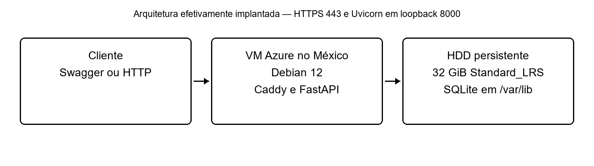

Figura 3. Arquitetura efetivamente implantada em Mexico Central.

## 10 Inventário real e custos verificados

Provedor de todos os recursos: Microsoft Azure. Região: Mexico Central. Assinatura consultada: Azure for Students; os recursos têm seus próprios SKUs tarifados, sem gratuidade individual presumida. Identificadores da assinatura/tenant e saldo dos créditos não são publicados. Os valores abaixo foram consultados na CLI autenticada e na API oficial de preços em 02/11/2026.
|Atributo|Máquina virtual|Disco gerenciado|IP público|
|Serviço|Azure Virtual Machines|Azure Managed Disks|Azure Public IP|
|Nome|vm-api-tarefas|disk-api-tarefas|ip-api-tarefas|
|Região|Mexico Central|Mexico Central|Mexico Central|
|SKU exato|Standard_B2ats_v2|Standard_LRS|Standard|
|vCPU e memória|2 vCPUs e 1 GiB|Não se aplica|Não se aplica|
|Armazenamento|Disco de SO da coluna ao lado|HDD persistente 32 GiB|Não se aplica|
|Sistema operacional|Debian GNU/Linux 12|Disco de SO Linux|Não se aplica|
|Finalidade|Caddy e API, uma instância|SO, SQLite e cópias locais|Endereço estático e DNS|
|Preço de referência|US$ 0,0103/h|US$ 1,6896/mês + operações|US$ 0,005/h|
|Fonte e data|Retail Prices API, 02/11/2026|Retail Prices API, 02/11/2026|Retail Prices API, 02/11/2026|
O catálogo de SKU confirmou 2 vCPUs/1 GiB. O disco retornou Standard_LRS e 32 GiB; o campo tier não foi retornado. S4 é a faixa de faturamento documentada para HDD de 32 GiB, e não um tier inventado. O sistema ext4 /dev/sda1 está montado em /. O IP tem alocação Static. A exportação pública do disco está bloqueada: DenyAll e PublicNetworkAccess Disabled.
|Recurso|Nome e finalidade|SKU e condição de custo|
|Grupo de recursos|rg-api-tarefas-academica, exclusivo deste projeto|Sem SKU de computação; organiza recursos|
|VNet e sub-rede|vnet-api-tarefas / subnet-api, rede da VM|Não se aplica; VNet sem tarifa básica|
|NSG|nsg-api-tarefas, regras públicas 80/443|Não se aplica; sem tarifa adicional de criação|
|Interface de rede|vm-api-tarefasVMNic, conecta VM/rede/IP|Sem SKU de VM; sem serviço tarifado separado adicionado|
Para os recursos de gestão/rede, CPU, memória, disco e SO próprios não se aplicam. Todos pertencem ao mesmo provedor/região. As condições de VNet/NSG foram verificadas em fontes oficiais; tráfego e serviços adicionais podem ser cobrados. Não foram criados peering, VPN, Bastion, balanceador ou backup externo.
A base de 730 horas é US$ 12,8586/mês, arredondada para US$ 12,86, aproximadamente US$ 0,42 por 24 horas. Acrescentam-se operações HDD a US$ 0,00055/10 mil e eventual tráfego, tributos/câmbio aplicáveis, antes de benefícios. É referência de varejo e não a fatura apurada. O consumo de créditos foi autorizado e o limite de gastos permaneceu ativo. Nenhuma gratuidade de VM/disco/IP foi presumida.
Evidências: recursos-azure.json, precos-verificados.json, runtime-backup.json e captura 11-recursos-sku-cli.png. Fontes: https://prices.azure.com/api/retail/prices; https://learn.microsoft.com/en-us/azure/virtual-network/virtual-networks-overview; https://marketplace.microsoft.com/en-us/product/azure-services/microsoft.networksecuritygroup?tab=overview.

## 11 Implantação operação backup e remoção passo a passo


### 11.1 Configuração efetivamente implantada

Verificada em 02/11/2026. Grupo exclusivo `rg-api-tarefas-academica`, região **Mexico Central**, VM `vm-api-tarefas`, SKU **Standard_B2ats_v2** (2 vCPUs, 1 GiB), imagem oficial `Debian:debian-12:12-gen2:0.20261026.2643`. Disco de SO `disk-api-tarefas`, **Standard_LRS/HDD, 32 GiB**, persistente; IP `ip-api-tarefas`, **Standard estático**. A VM está ligada e foi mantida assim para apresentação.

URL base: https://tarefas-academica-shamiryy-20261102.mexicocentral.cloudapp.azure.com

- Lista pública: https://tarefas-academica-shamiryy-20261102.mexicocentral.cloudapp.azure.com/tarefas
- Swagger: https://tarefas-academica-shamiryy-20261102.mexicocentral.cloudapp.azure.com/docs
- Saúde: https://tarefas-academica-shamiryy-20261102.mexicocentral.cloudapp.azure.com/health

O caminho raiz `/` não tem rota. Use `/docs` ou `/tarefas` para abrir a aplicação.

### 11.2 Disponibilidade e preços

A assinatura restringe regiões a Canada Central, Central US, Mexico Central, Chile Central e South Africa North. Consultas autenticadas encontraram B1s indisponível; B2ats_v2 sem bloqueio regional nas três últimas. Isso foi seguido da criação bem-sucedida em Mexico Central. Imagem Debian sem plano adicional de Marketplace (plan null).

Preços de varejo oficiais em Mexico Central, consultados em 02/11/2026:

|Item|Valor|Condição|
|---|---|---|
|B2ats v2 Linux|US$ 0,0103/h|Computação em funcionamento|
|IP Standard IPv4|US$ 0,005/h|Recurso alocado|
|HDD S4 LRS 32 GiB|US$ 1,6896/mês|Disco gerenciado persistente|
|Operações HDD|US$ 0,00055/10 mil|Dependem do uso|

Base de 730 horas: **US$ 12,8586/mês**, aproximadamente US$ 0,42 por 24 horas. Mais operações e eventual tráfego, tributos/câmbio aplicáveis, antes de franquias ou benefícios. São preços de referência e não uma fatura apurada. Fonte: https://prices.azure.com/api/retail/prices, arquivo `docs/evidencias/nuvem/precos-verificados.json`. VNet/sub-rede e NSG não têm tarifa básica de criação; a NIC padrão não adicionou um serviço tarifado separado nesta implantação. Não há Bastion, balanceador, conta Storage, Log Analytics ou backup externo contratado por este projeto.

O consumo de créditos acadêmicos foi autorizado. O limite de gastos da assinatura foi mantido. Saldo e identificadores de assinatura não são publicados. Não foi presumida gratuidade de VM/disco/IP.

O HDD foi escolhido pelo menor custo para a demonstração pequena e passou nos testes. A Microsoft recomenda SSD para sistemas operacionais e bancos transacionais em produção; não se trata de uma recomendação de HDD para produção.

### 11.3 Provisionamento reproduzível

Os recursos já existem; **não execute o provisionador novamente para atualizar a API**. Para reproduzir em outra implantação autorizada, tenha Azure CLI autenticado e Git. Confirme assinatura, região permitida, disponibilidade, quota e preços. O DNS global deverá ser único. Na raiz:

```powershell
./deploy/provisionar.ps1 -AutorizarConsumoDeCreditos -Regiao mexicocentral -Tamanho Standard_B2ats_v2 -Dns NOME_DNS_UNICO
```

O script protege contra nova criação quando a VM já existe, verifica spendingLimit On, cria grupo exclusivo e VM, gera chave SSH local sem publicá-la e configura somente 80/443. Os comandos executados nesta implantação usaram uma chave exclusiva na pasta privada local. A porta SSH pública permaneceu fechada; a administração usa Azure Run Command autenticado.

A imagem foi fixada à versão verificada. Em uma implantação futura, confirme se a imagem continua disponível e se o SKU ainda possui capacidade. Uma falha deve ser inspecionada; recursos incompletos do projeto devem ser removidos antes de tentar outra região. Não altere outros grupos.

### 11.4 Instalação do código e HTTPS

```powershell
./deploy/instalar-azure.ps1
```

Esse script lê o FQDN do IP real, prepara payload para **Bash** e chama Azure Run Command. No Debian, Run Command usa `/bin/sh`; por isso o wrapper chama Bash explicitamente antes de usar `set -euo pipefail`. O instalador instala Python/venv, Git, Caddy e curl, clona o repositório em `/opt/tarefas`, instala requirements.txt e cria usuário de serviço `tarefas`.

O SQLite fica em `/var/lib/tarefas/tarefas.db`, com pasta privada e arquivo 600. O disco é `/dev/sda1`, ext4 montado em `/`, confirmado por findmnt. Não se usa armazenamento temporário. A exportação pública do disco está bloqueada (networkAccessPolicy DenyAll e publicNetworkAccess Disabled). Isso não é um endpoint do banco.

A unidade `tarefas.service` usa um worker, reinício em falhas, usuário sem shell, NoNewPrivileges, ProtectSystem e escrita permitida em /var/lib/tarefas. Caddy encaminha HTTPS para `127.0.0.1:8000`, sem servir arquivos. Sua configuração local de produção usa o FQDN real; deploy/Caddyfile é um modelo com domínio de exemplo explicitamente inválido.

O certificado Let's Encrypt foi obtido e validado sem desativar verificação TLS. Foi observado TLS 1.3 e redirect HTTP 308. Detalhes e validade no arquivo `https-rede.json`. A renovação é administrada pelo Caddy enquanto a VM, o DNS e a conectividade estiverem disponíveis.

Não considere o texto `Provisioning succeeded` do Run Command como sucesso suficiente: confira stdout/stderr, serviços, HTTPS e CRUD. A primeira tentativa encontrou diferença de shell e foi corrigida; a implantação bem-sucedida foi comprovada pelos testes públicos posteriores.

### 11.5 Testes públicos executados

Foram registradas 23 requisições com assertions, além de operações capturadas no Swagger. Incluem POST 201, GET 200, PUT 200, DELETE 204, consulta após exclusão 404, entradas inválidas 422, atualização inválida preservando dados, listagem e registro ausente. Uma tarefa ID 2 foi consultada antes, depois de reiniciar o serviço e depois de reiniciar a VM: todos os campos permaneceram iguais. Veja `testes-publicos.json`, `testes-publicos.txt`, `persistencia-publica.json` e prints `08`, `09` e `10` em docs/evidencias/nuvem.

Para reproduzir:

```powershell
.venv/Scripts/python.exe -m pip install -r requirements-docs.txt
.venv/Scripts/python.exe -m playwright install chromium
.venv/Scripts/python.exe scripts/verify_public.py --base-url https://tarefas-academica-shamiryy-20261102.mexicocentral.cloudapp.azure.com --restart-azure
```

O script usa o Azure CLI autenticado para `systemctl restart tarefas` e `az vm restart`, aguardando o retorno do HTTPS. Não execute durante outra apresentação. Para testar apenas HTTP/Swagger sem reiniciar, omita `--restart-azure`.

Verificações adicionais: /docs, /redoc e /openapi.json 200; arquivos de banco/.env 404; portas 22/8000 não acessíveis da origem de teste; 80/443 abertas. O /health foi apenas uma das verificações.

### 11.6 Operação e atualização

No portal Azure: VM → Executar comando → RunShellScript. Exemplos:

```sh
systemctl is-active tarefas caddy
systemctl status tarefas --no-pager
journalctl -u tarefas -n 50 --no-pager
journalctl -u caddy -n 50 --no-pager
```

Para atualizar o código, primeiro faça backup. Em Run Command, use `set -eu`, `git -C /opt/tarefas pull --ff-only`, `/opt/tarefas/.venv/bin/pip install -r /opt/tarefas/requirements.txt` e `systemctl restart tarefas`. Não remova /var/lib/tarefas. Confirme a versão e refaça o CRUD e a consulta de um ID anterior. Mudanças futuras de esquema exigem migração; este projeto cria a tabela inicial, mas não tem migrações automáticas.

As versões efetivas na VM foram Python 3.11.2, SQLite 3.40.1, FastAPI 0.162.0, Uvicorn 0.54.0, Pydantic 2.14.2, Starlette 1.10.0 e Caddy 2.6.2. Veja runtime-backup.json. O código da aplicação testado corresponde ao commit registrado nesse arquivo; os commits seguintes também incluem documentação e ferramentas de implantação.

### 11.7 Backup e restauração

O script usa a Online Backup API do SQLite e integrity_check. Crie destino novo, nunca publique o banco:

```sh
install -d -m 700 -o tarefas -g tarefas /var/lib/tarefas/backups
runuser -u tarefas -- /opt/tarefas/.venv/bin/python /opt/tarefas/scripts/backup.py /var/lib/tarefas/tarefas.db /var/lib/tarefas/backups/backup-NOME_UNICO.db
```

Backup e restauração em arquivo separado **foram executados na VM**: um registro fictício comparado, dados idênticos e integridade ok. O banco público não foi substituído durante esse teste. O script de verificação está em scripts/check_runtime.sh e o resultado em runtime-backup.json.

As cópias estão no mesmo disco, sem agendamento e sem armazenamento externo: não protegem contra exclusão/perda desse disco. Antes de excluir o grupo, transfira uma cópia para local privado fora dele, se precisar dos dados. A chave privada local não deve ser publicada nem enviada pelo chat. Armazenamento externo adicional não foi contratado.

Para restaurar no banco da API, via Run Command, adaptando BACKUP_EXISTENTE e nomes novos:

```sh
set -eu
systemctl stop tarefas
cp -p /var/lib/tarefas/tarefas.db /var/lib/tarefas/backups/antes-restauracao-NOME_UNICO.db
cp BACKUP_EXISTENTE /var/lib/tarefas/tarefas.db
chown tarefas:tarefas /var/lib/tarefas/tarefas.db
chmod 600 /var/lib/tarefas/tarefas.db
/opt/tarefas/.venv/bin/python -c 'import sqlite3; c=sqlite3.connect("/var/lib/tarefas/tarefas.db"); assert c.execute("PRAGMA integrity_check").fetchone()[0]=="ok"; c.close()'
systemctl start tarefas
```

Depois consulte registros conhecidos pela URL pública. Não execute a substituição com a aplicação ativa. Se a integridade falhar, mantenha o serviço parado e recupere a cópia preservada. O procedimento de substituição do banco ativo está documentado; o teste real usou arquivo separado.

### 11.8 Prints adicionais do portal

As evidências obrigatórias de CRUD, testes, persistência e repositório foram capturadas. A infraestrutura tem capturas identificadas de **saídas reais da CLI**, não de um painel simulado. Para complementar com telas do portal autenticado:

1. Azure → Grupos de recursos → rg-api-tarefas-academica → Visão geral: mostre os recursos e a região.
2. VM vm-api-tarefas → Visão geral ou Tamanho: nome, Linux, Mexico Central, Standard_B2ats_v2, 2 vCPUs e 1 GiB.
3. VM → Discos e depois disk-api-tarefas → Visão geral: Standard HDD LRS, 32 GiB, disco de SO gerenciado.
4. ip-api-tarefas → Visão geral/Configuração: SKU Standard, estático e DNS; NSG → regras de entrada: somente regras públicas 80/443.

Oculte nome pessoal, email, ID da assinatura, tenant e informações financeiras. Não é necessário mostrar saldo dos créditos. Confirme que cada imagem está legível e corresponda aos nomes reais. Essas telas complementam o inventário já comprovado pela CLI; não precisam ser inventadas para concluir os testes técnicos.

### 11.9 Interromper e excluir para evitar consumo posterior

Os recursos permanecem ligados para apresentação. Para pausa temporária:

```powershell
az vm deallocate -g rg-api-tarefas-academica -n vm-api-tarefas
```

Desalocar para a computação, mas disco e IP alocados podem continuar consumindo créditos. Desligar apenas dentro do Linux não equivale a desalocar. Não remova o limite de gastos.

Para encerrar definitivamente após a entrega, salve o material e eventual backup privado e confira o grupo exclusivo:

```powershell
az resource list -g rg-api-tarefas-academica -o table
az group delete -n rg-api-tarefas-academica --yes
az group exists -n rg-api-tarefas-academica
```

A confirmação final deve ser `false`. Confira também o custo final no portal, que pode aparecer com atraso. A exclusão é irreversível e remove VM, disco/banco, IP e rede deste grupo. O repositório e os relatórios publicados no GitHub permanecem. **Nenhuma exclusão foi executada após os testes.**

## 12 Persistência e backup observados

O arquivo do banco fica separado do código, em /var/lib/tarefas/tarefas.db. Atualizar /opt/tarefas não deve substituí-lo. Reiniciar o serviço ou a VM não recriou o arquivo: o ID 2 permaneceu idêntico. O código cria a tabela inicial, mas não contém migrações automáticas de esquema.
A API de backup SQLite produz uma cópia consistente, inclusive com banco ativo. scripts/backup.py rejeita origem inexistente, mesmo destino ou sobrescrita, e verifica PRAGMA integrity_check. Na VM, a cópia foi restaurada em arquivo separado e comparada com o conteúdo do backup, com um registro e integridade ok. O banco público não foi substituído durante o teste.
As cópias atuais estão no mesmo disco, sem agendamento ou cópia externa automática, portanto não protegem contra exclusão/perda do disco. Para restaurar o banco ativo é preciso parar o serviço, preservar o arquivo atual, copiar o backup, ajustar tarefas:tarefas e 600, verificar integridade, iniciar e consultar registros conhecidos. Os comandos completos estão na seção anterior. Antes de excluir a nuvem, transfira uma cópia para local privado fora do grupo se precisar dos dados. Nunca publique bancos ou backups no GitHub.

## 13 Segurança e limitações

Esta é uma demonstração pública sem autenticação. Qualquer pessoa que alcance os endpoints pode criar, consultar, alterar e excluir qualquer tarefa. Não há controle de autoria, autorização, auditoria de usuário ou limitação de requisições. HTTPS protege o tráfego, mas não impede operações indevidas por clientes autorizados pela rede. Use exclusivamente dados fictícios e mantenha a demonstração pública somente pelo período necessário.
As consultas parametrizadas evitam injeção SQL nos valores, mas não resolvem abuso, consumo de disco ou negação de serviço. A validação limita o tamanho dos campos e a listagem, porém não substitui limites de infraestrutura. Uma única VM e um único banco não oferecem alta disponibilidade. Falha do disco sem backup pode causar perda de dados.
Os arquivos .env, chaves, bancos e a pasta .private são ignorados. Capturas foram produzidas com dados fictícios. Não se deve publicar IDs de assinatura, emails pessoais, chaves, tokens ou detalhes financeiros do portal. As limitações são explicitadas para apresentação acadêmica; esta solução não deve receber dados pessoais em produção.
Na VM efetiva, o SQLite tem proprietário tarefas e permissão 600. Uvicorn está em loopback. O NSG não libera SSH ou 8000 publicamente, e as consultas externas confirmaram que essas portas não eram acessíveis da origem de teste. As respostas 404 para banco/.env e a política DenyAll do disco foram verificadas. Ainda assim, qualquer visitante pode usar os endpoints públicos sem autenticação.
A VM pequena usa CPU burstable e o HDD tem variabilidade de latência. Não houve teste de carga. As melhorias possíveis incluem autenticação/autorização, limites de requisição, SSD, auditoria, migrações e backup externo. Para múltiplas instâncias, deve-se reavaliar o banco, por exemplo PostgreSQL. Essas melhorias não fazem parte da implementação atual.

## 14 Evidências reais e capturas adicionais

As figuras distinguem execução local, API hospedada, GitHub e infraestrutura consultada pela CLI. As respostas capturadas são Server response real do Swagger, não apenas seus exemplos. As capturas de inventário/runtime mostram resultados reais consultados e consolidados, com IDs omitidos; não simulam o portal Azure.
Foram capturados Swagger público, criação, consulta, atualização, exclusão, consulta 404 posterior, validação 422, estados antes/depois de serviço/VM, testes, recursos/SKU, backup e GitHub. Os diagramas explicam a implementação e não são utilizados como provas de execução.
As telas complementares do portal autenticado ainda não foram capturadas. Para obtê-las, abra o grupo rg-api-tarefas-academica; VM → Visão geral/Tamanho; VM → Discos → disk-api-tarefas; IP ip-api-tarefas → Visão geral/Configuração; NSG → Regras de entrada. Devem aparecer Mexico Central, Standard_B2ats_v2, 2 vCPUs, 1 GiB, HDD 32 GiB, IP Standard estático e regras públicas 80/443. Oculte nome pessoal, email, IDs e dados financeiros; não é necessário mostrar saldo. Essas telas complementam o inventário já comprovado pela CLI.

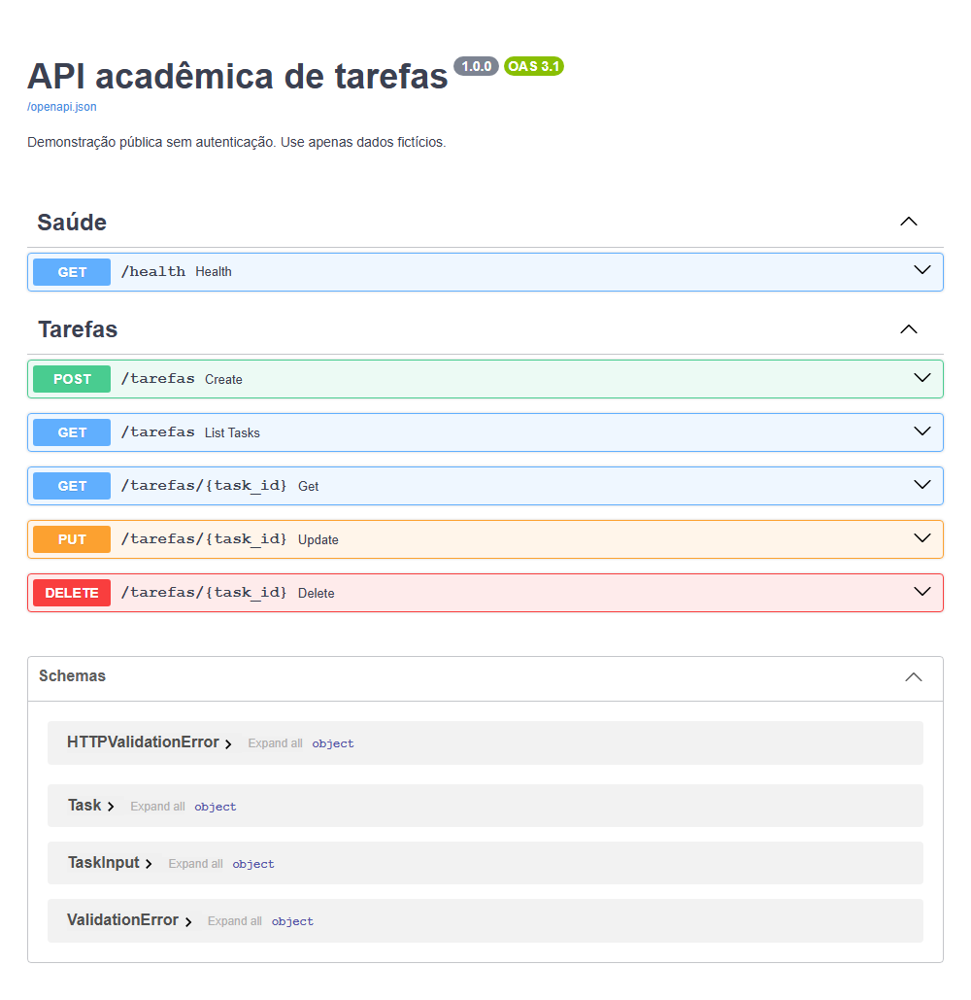

Figura 4. Nuvem: documentação interativa real da API hospedada em HTTPS.

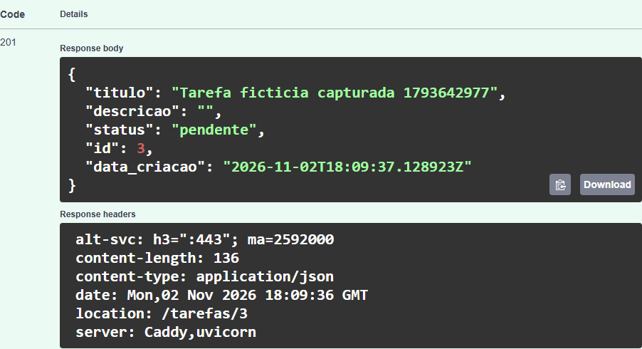

Figura 5. Nuvem: criação com HTTP 201 e Location.

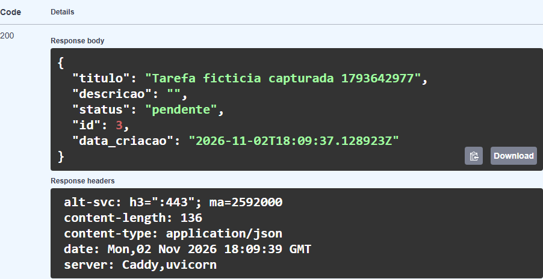

Figura 6. Nuvem: consulta da tarefa criada com HTTP 200.

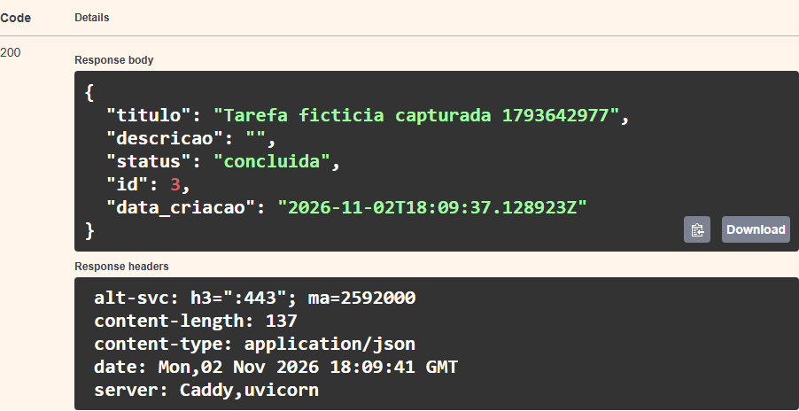

Figura 7. Nuvem: atualização para concluida com HTTP 200.

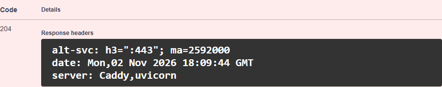

Figura 8. Nuvem: exclusão com HTTP 204 sem corpo.

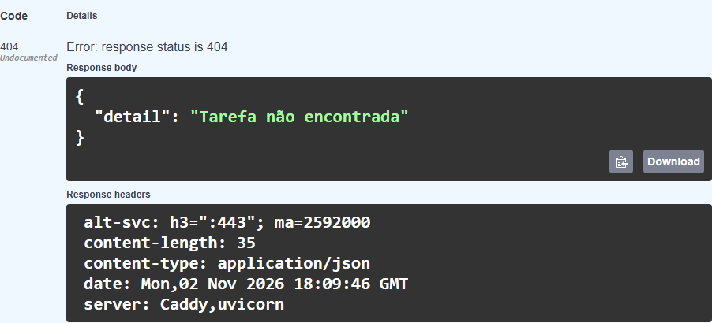

Figura 9. Nuvem: consulta após exclusão com HTTP 404.

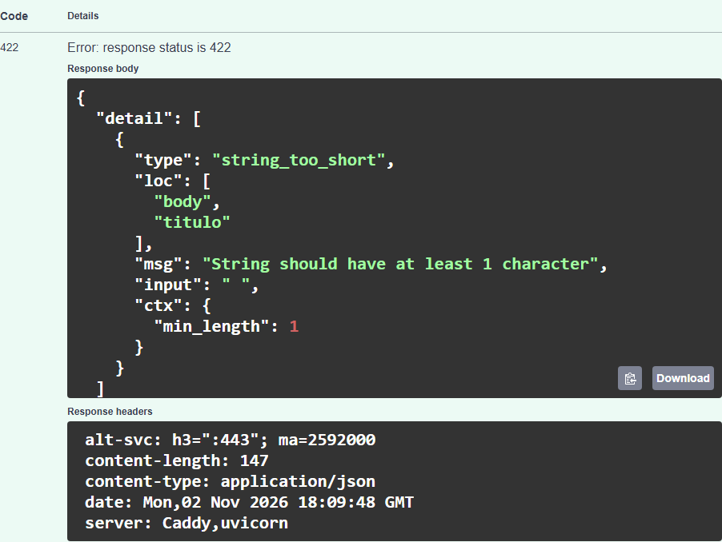

Figura 10. Nuvem: título inválido rejeitado com HTTP 422.


Figura 11. Nuvem: tarefa de persistência antes dos reinícios.


Figura 12. Nuvem: mesmo registro após reiniciar o serviço tarefas.

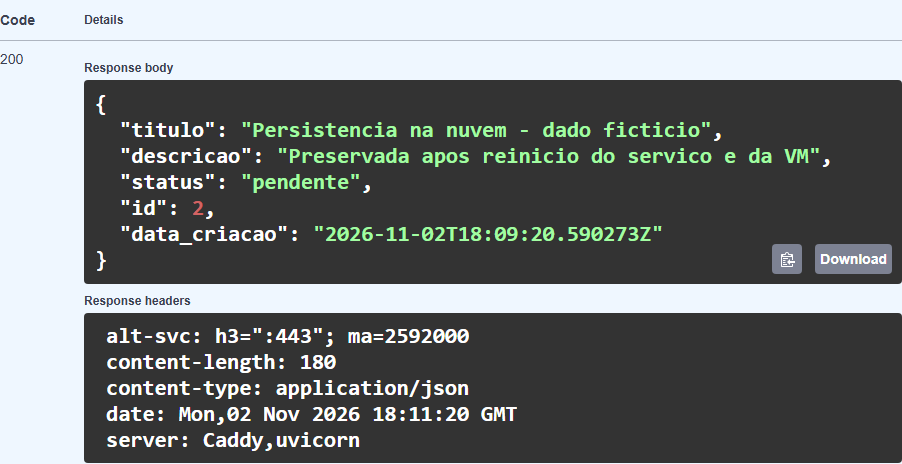

Figura 13. Nuvem: mesmo registro após reiniciar a VM Azure.

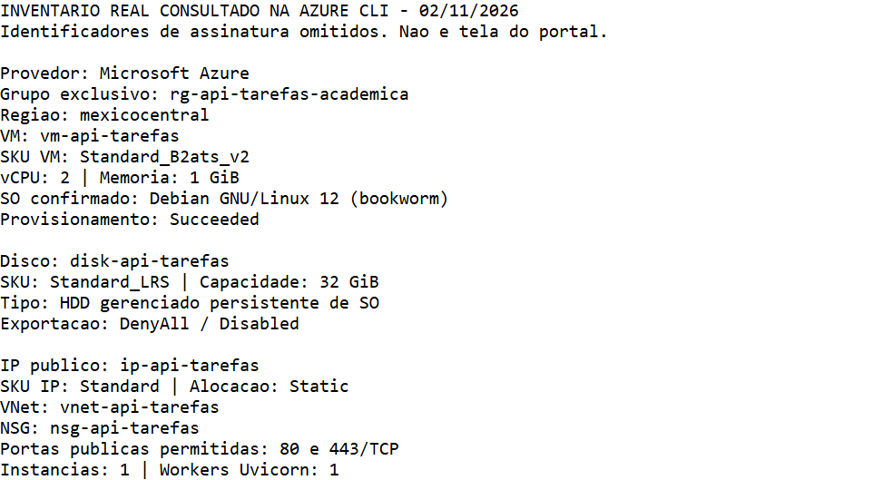

Figura 14. Inventário real consultado na Azure CLI, com IDs omitidos. Captura do resultado consolidado; não é tela do portal.

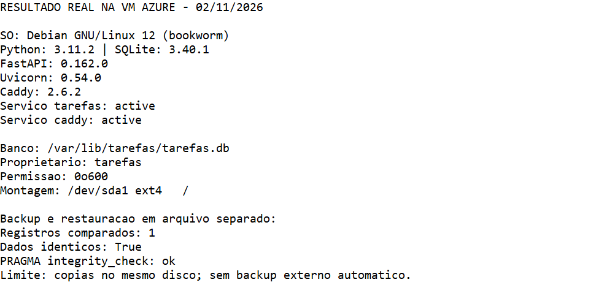

Figura 15. Resultado real na VM: versões, serviços, banco e backup/restauração em arquivo separado.

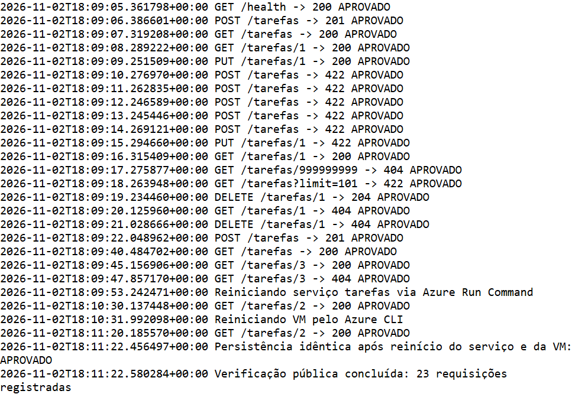

Figura 16. Log real das verificações públicas e reinícios com assertions.

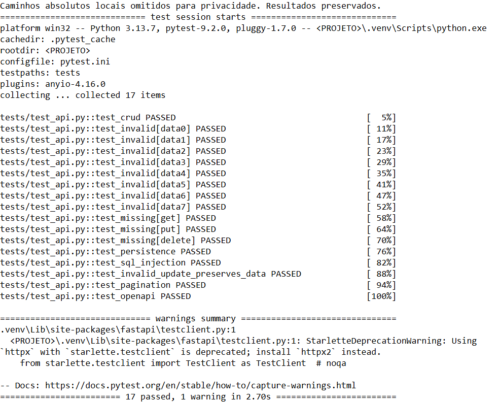

Figura 17. Execução local: 17 testes aprovados; caminhos pessoais omitidos.

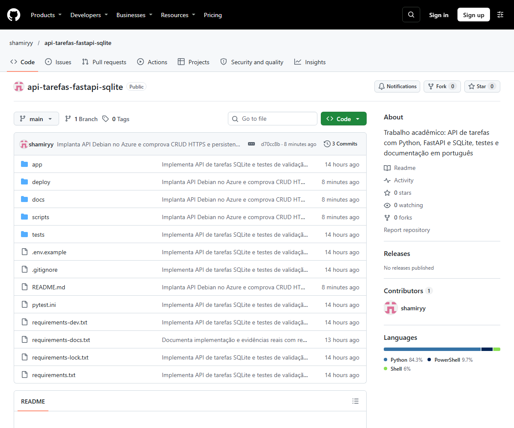

Figura 18. Repositório público no GitHub, capturado em navegador após publicar a implantação.

## 15 Requisitos e situação final

|Requisito|Status|Evidência|
|API SQLite e CRUD|Concluído|Código, 17 testes locais e respostas públicas|
|Validação e erros HTTP|Concluído|422/404 registrados; tratamento SQLite no código|
|Hospedagem de ponta a ponta|Concluído|VM real, HTTPS e CRUD público|
|Persistência após reinício|Concluído|ID 2 idêntico após serviço e VM|
|GitHub público|Concluído|Código e documentos enviados; commit remoto verificado|
|Três esquemas renderizados|Concluído|Arquitetura, modelo e fluxo PNG|
|Prints reais|Concluído|Swagger público, testes, GitHub e inventário CLI|
|VM armazenamento e SKU|Concluído|Inventário real e referências oficiais|
|Word e PDF detalhados|Concluído|Arquivos gerados e páginas revisadas|
|Backup e restauração em arquivo separado|Concluído|Teste na VM, dados idênticos e integridade ok|
|Identificação acadêmica|Pendente|Preencher nome, matrícula, turma, disciplina e professor|
|Telas complementares do portal|Pendente opcional|Páginas indicadas, sem dados sensíveis|
|Exclusão após apresentação|Pendente|Encerrar recursos quando a entrega terminar|
A estudante precisa preencher a identificação, baixar e conferir os documentos e, se desejar telas do painel para a apresentação, acrescentar as capturas indicadas. Não há ação manual de deploy, senha ou chave pendente para o funcionamento atual.
As evidências registram o estado observado em 02/11/2026. Como não há autenticação, visitantes podem alterar dados após os testes. Não foi prometida gratuidade permanente nem disponibilidade garantida.

## 16 Encerramento e consumo posterior

Os recursos permanecem ligados para apresentação e podem continuar consumindo créditos. Desalocar com az vm deallocate interrompe computação, mas disco/IP podem continuar tarifados. Desligar apenas no Linux não equivale a desalocar. O procedimento completo de remoção está na seção 11 e em docs/implantacao.md.
Após salvar os materiais e eventual backup fora do grupo, confira seus recursos e exclua somente rg-api-tarefas-academica. Confirme que az group exists retorna false e confira custos finais no portal, sujeitos a atualização posterior. A exclusão é irreversível e remove banco/disco/VM/IP/rede do grupo. GitHub e documentos baixados permanecem. Não execute antes da apresentação se precisar da URL online. Nenhuma exclusão foi realizada ao concluir os testes.

## 17 Referências técnicas

Fontes oficiais consultadas em 02/11/2026:
FastAPI. SQL Relational Databases: https://fastapi.tiangolo.com/tutorial/sql-databases/
Python. sqlite3: https://docs.python.org/3/library/sqlite3.html
SQLite. Online Backup API: https://www.sqlite.org/backup.html
Caddy. Automatic HTTPS: https://caddyserver.com/docs/automatic-https
Microsoft. Azure for Students: https://azure.microsoft.com/en-us/free/students
Microsoft. About Azure for Students: https://learn.microsoft.com/azure/education-hub/about-azure-for-students
Microsoft. Linux VM Azure CLI quickstart: https://learn.microsoft.com/en-us/azure/virtual-machines/linux/quick-create-cli
Microsoft. Azure Retail Prices API: https://learn.microsoft.com/en-us/rest/api/cost-management/retail-prices/azure-retail-prices
Microsoft. App Service Linux limitations: https://github.com/Azure/app-service-linux-docs/blob/master/Things_You_Should_Know/things_you_should_know.md
Microsoft. Reactivate Azure for Students subscription: https://learn.microsoft.com/en-us/azure/cost-management-billing/manage/azurestudents-subscription-disabled

Microsoft. Basv2 sizes series. https://learn.microsoft.com/en-us/azure/virtual-machines/sizes/general-purpose/basv2-series
Microsoft. Linux distributions endorsed on Azure. https://learn.microsoft.com/en-us/azure/virtual-machines/linux/endorsed-distros
Microsoft. Managed disk types. https://learn.microsoft.com/en-us/azure/virtual-machines/disks-types
Microsoft. Virtual Network overview. https://learn.microsoft.com/en-us/azure/virtual-network/virtual-networks-overview
Microsoft. Network security group. https://marketplace.microsoft.com/en-us/product/azure-services/microsoft.networksecuritygroup?tab=overview
As fontes sustentam conceitos e condições gerais; a implantação individual é comprovada pelos arquivos de evidência. A documentação do provedor não substitui os testes reais nem comprova saldo ou benefício gratuito individual.

## 18 Explicação para apresentação oral

A API gerencia tarefas fictícias: permite criar, listar, consultar, atualizar e excluir. Foi desenvolvida em Python com FastAPI, que valida os dados e oferece documentação Swagger. O SQLite salva registros em um arquivo acessado com consultas parametrizadas. A aplicação está hospedada em uma VM Debian 12 da Azure, em Mexico Central. A VM executa a API, o disco persistente conserva o banco e o Caddy fornece HTTPS. O SKU Standard_B2ats_v2 identifica o tamanho de 2 vCPUs e 1 GiB. Os testes públicos passaram, inclusive após reiniciar o serviço e a VM. Código e evidências estão no GitHub. Após a apresentação, os recursos devem ser excluídos para encerrar o consumo de créditos.
